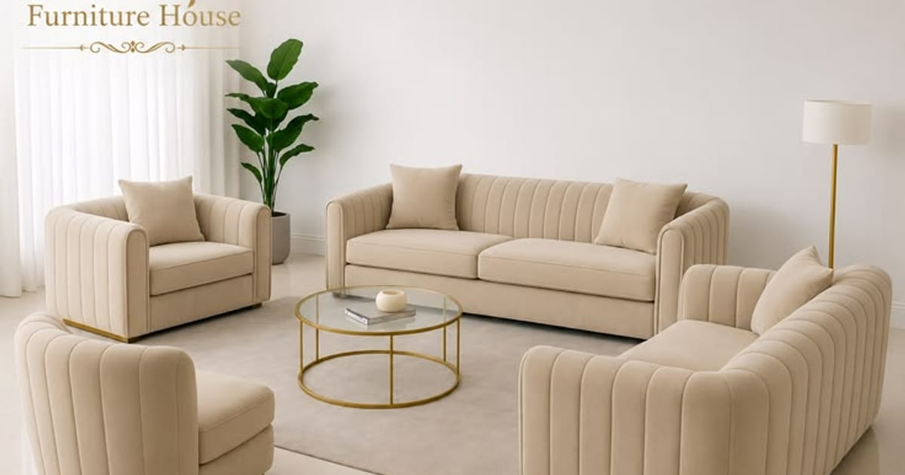

<div align="center">

# Fine Furniture — Debre Markos

**A curated furniture gallery and showroom website for Fine Furniture, Debre Markos, Ethiopia.**

[](https://site-17535a427e0a4894b2f0a2a9146961e1.freebuff.page/)
[](https://workers.cloudflare.com/)
[](https://developers.cloudflare.com/d1/)
[](#tech-stack)
[](#scripts)

**[Open the live site →](https://site-17535a427e0a4894b2f0a2a9146961e1.freebuff.page/)**



</div>

---

## Overview

Fine Furniture is a family furniture business in Debre Markos with three showrooms and an in-house
workshop. This repository is its website: a fast, SEO-complete catalogue of the pieces on the floor,
plus the practical details a customer needs — what is available, where the showrooms are, and how to
talk to the shop.

It is deliberately **not an online shop**. There is no cart, checkout, payment, inventory or admin
panel, and prices are never published. Customers create an account only to save and compare pieces
from the collection.

## Features

- **107-piece catalogue** across sofas, chairs, dining sets, beds, tables, storage and office furniture,
  with category, material and search filtering.
- **Product pages** with responsive photography, dimensions, materials and finish options.
- **Accounts** with PBKDF2-hashed passwords and signed, HttpOnly session cookies.
- **Saved and compared pieces** stored per account in D1 — no public wishlists, no tracking.
- **Server-rendered SEO** for every route: unique titles, canonicals, Open Graph/Twitter cards and
  JSON-LD (`Product`, `BreadcrumbList`, `FurnitureStore`, `WebSite`), plus `sitemap.xml` and `robots.txt`.
- **Bilingual copy** (English and Amharic) with self-hosted WOFF2 subsets.
- **No third-party runtime** — no image CDN, font CDN, analytics or trackers.

## Tech stack

| Layer | Choice |
| --- | --- |
| Runtime | Cloudflare Workers (ES modules) |
| Data | Cloudflare D1 (SQLite) for catalogue, accounts, saved and compared pieces |
| Client | Plain HTML, CSS and JavaScript — no framework, no runtime dependencies |
| Media | Self-hosted WebP with JPEG fallback, 480/960/1440 variants and intrinsic sizes |
| Build | `esbuild` for CSS/JS minification and Worker bundling; `sharp` for image regeneration |

## Project structure

```text
worker.js                 document shell, SEO injection, routing, 404/500, static assets
src/api.js                JSON API (/api/catalogue, /api/auth/*, /api/wishlist, /api/compare, …)
src/db.js                 schema, gallery seeding, price-free product projection
src/auth.js               password hashing, sessions, secure cookies
src/showcase.js           curated catalogue — single source of truth for the 107 pieces
src/upload-pieces.js      uploaded photograph manifest consumed by the catalogue
src/products.js           product projection and filtering helpers
src/validate.js           request validation
src/mail.js               transactional email templates
public/index.html         document shell (metadata completed per route by the Worker)
public/500.html           static error page
public/assets/css/        source styles, concatenated into site.min.css
public/assets/js/         source scripts, concatenated into site.min.js
public/assets/img/        responsive gallery photos, social cover, icons
public/assets/fonts/      self-hosted WOFF2 subsets
tools/build.mjs           CSS/JS/Worker production build
tools/build-images.mjs    regenerates responsive photos, social cover and icons
tools/build-fonts.mjs     regenerates the self-hosted font sheet
tools/gen-uploads.mjs     regenerates the upload manifest
tools/check.mjs           syntax, metadata, price-free, image and bundle checks
sites-deploy.json         deployment manifest (dist/worker.js + public/)
```

## Getting started

**Requirements:** Node.js 20+ and npm.

```bash
git clone https://github.com/yemizerfe/FineFurniture-Site.git
cd FineFurniture-Site
npm ci
npm run dev
```

The local server runs on <http://localhost:8787> using `wrangler.local.jsonc`. Local development uses a
placeholder D1 database that Wrangler creates and seeds on first run — no Cloudflare account is needed.

## Scripts

| Command | What it does |
| --- | --- |
| `npm run dev` | Wrangler dev server on port 8787 |
| `npm run build` | Minifies CSS/JS, bundles `dist/worker.js`, reports gzip/brotli sizes |
| `npm test` | Production checks: syntax, metadata, price-free guarantees, image variants, bundle sizes |
| `npm run build:images` | Regenerates responsive photos and icons (needs `sharp` and the original photos) |
| `npm run build:fonts` | Regenerates the self-hosted font sheet |

Always run `npm run build` before deploying: the deployment manifest uploads `dist/worker.js` and `public/`.

## Deployment

`sites-deploy.json` points at `dist/worker.js` and `public/`. The site is hosted on Freebuff Sites
(Cloudflare Workers + D1). To deploy a preview:

```bash
npm ci && npm run build
```

then deploy with the Sites tooling using `sites-deploy.json` as the manifest. Production is published
only on the owner's instruction. Deployment secrets belong in the hosting dashboard, never in this
repository; `wrangler.local.jsonc` is development-only and its database ID is a placeholder.

## Configuration

Optional features stay hidden until these secrets are set in the hosting dashboard:

| Secret | Enables |
| --- | --- |
| `GOOGLE_CLIENT_ID`, `GOOGLE_CLIENT_SECRET` | Google sign-in |
| `RESEND_API_KEY`, `MAIL_FROM` | Password-reset email |

## Quality notes

- **Performance** — one deferred JS bundle, one CSS file, immutable caching for photos and fonts,
  explicit image dimensions, lazy loading below the fold and a preloaded hero image.
- **Accessibility** — semantic landmarks, visible focus states, labelled controls, reduced-motion and
  save-data friendly behaviour.
- **Security** — HSTS, `nosniff`, `DENY` framing, strict referrer and permissions policies, a CSP with
  per-response hashes and no inline script execution, same-origin checks on mutations, server-side
  validation and rate limits on auth and write endpoints.
- **Privacy** — `/privacy` documents exactly what is stored and why. No analytics, advertising or
  tracking; account deletion is handled by the shop on request.

## Known limitations

- Google sign-in and password-reset email remain hidden until the secrets above are configured.
- No self-service account deletion; the privacy page explains the phone/visit route.
- Lighthouse and Core Web Vitals field data are not part of `npm test` — the build only reports bundle sizes.

## Contact

Fine Furniture, Debre Markos, Ethiopia
Phone: [0920 282861](tel:+251920282861) · Monday to Saturday, 9:00–17:00

---

<sub>© Fine Furniture, Debre Markos. Source code is proprietary; the catalogue photography belongs to the shop.</sub>
